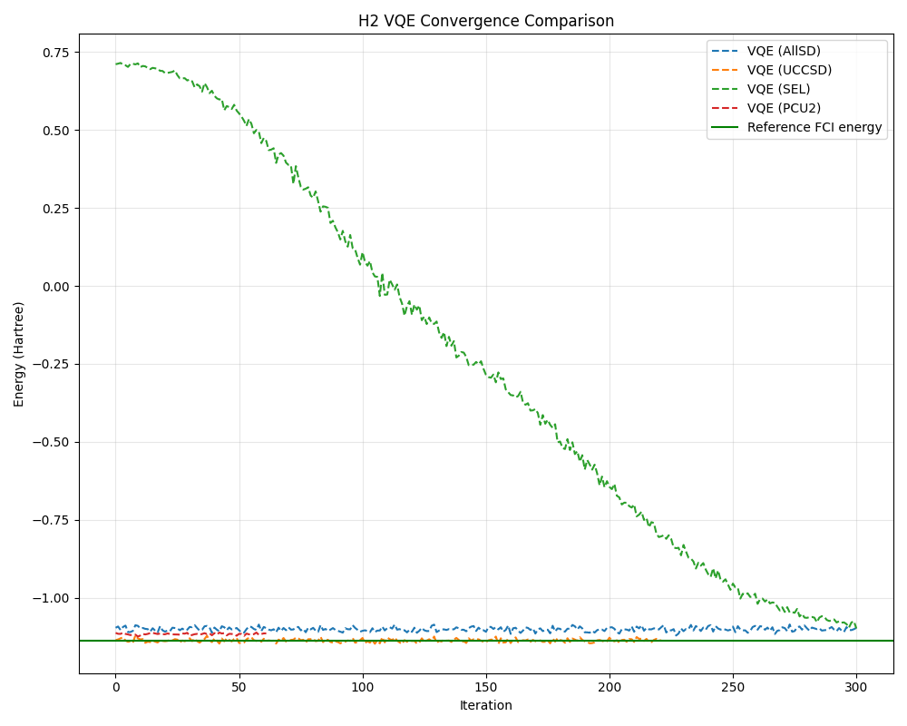

# Variational Quantum Eigensolver with PennyLane

A small independent summer project exploring the variational quantum eigensolver (VQE) for molecular ground-state energy estimation. I used [PennyLane](https://pennylane.ai/) to compare different parameterised circuits, experiment with noisy simulations and try running circuits on IBM quantum hardware.

The main aim was to get more familiar with quantum chemistry algorithms and the practical difficulties of running them, rather than to produce a comprehensive benchmark.

## What it does

The code builds a molecular Hamiltonian from PennyLane's quantum chemistry datasets and minimises its expectation value using a parameterised quantum circuit and the Adam optimiser:

\[
E(\boldsymbol{\theta}) = \langle \psi(\boldsymbol{\theta}) | H | \psi(\boldsymbol{\theta}) \rangle.
\]

I experimented with four ansätze:

- `AllSinglesDoubles`
- `UCCSD`
- `StronglyEntanglingLayers` (`SEL`)
- `ParticleConservingU2` (`PCU2`)

The script also includes optional frozen-core calculations, circuit resource estimates, energy-landscape plots, a basic depolarising-noise experiment and some exploratory tests of gradient variance with circuit depth. There is an optional IBM Quantum execution section using the PennyLane–Qiskit interface. I successfully ran earlier H2 circuits on IBM hardware, but did not retain the measured results, so there are no hardware benchmarks included here.

## Example result



An exploratory H2 convergence comparison from the project. The different circuits show quite different optimisation behaviour, especially the more general `StronglyEntanglingLayers` ansatz. This is not a controlled comparison of ansatz performance: the circuit structures, initial states and effective noise treatment differ.

## Running the code

The main script is `pennylane_vqe_github.py`. It uses Python with PennyLane, NumPy and Matplotlib. The IBM hardware section additionally requires Qiskit, the PennyLane–Qiskit plugin and an IBM Quantum account configured locally.

Install the local simulation dependencies in a Python environment, for example:

```bash
pip install pennylane pennylane-lightning matplotlib
```

Then run:

```bash
python pennylane_vqe_github.py
```

The settings near the bottom of the script control the molecule, ansätze, number of shots and whether to use the ideal (`'theory'`) or noisy (`'noise'`) simulation. The default molecule in the uploaded script is LiH; H2 is a smaller starting point. Optional experiments and IBM execution are disabled by default. PennyLane's quantum chemistry dataset needs to be downloaded on first use.

The project was developed as an exploratory script, not a packaged library, and I have not pinned or tested a reproducible set of dependency versions.

## Limitations

There are a few important caveats to interpreting the results:

- The noise model inserts depolarising channels on selected excitation gates, so it does not affect all four ansätze in an equivalent way. It is not a realistic device-calibrated noise model.
- The optimiser uses a simple stopping condition based on successive energy values, which can be unreliable with finite-shot estimates.
- The ansätze differ in parameterisation and initialisation, so the plots should not be taken as evidence that one is generally better than another.
- Some of the analysis sections are experiments I added while learning and have not been systematically validated.

The repository is mainly a record of what I tried and learned while getting to grips with VQE, quantum chemistry simulations and real quantum hardware.
